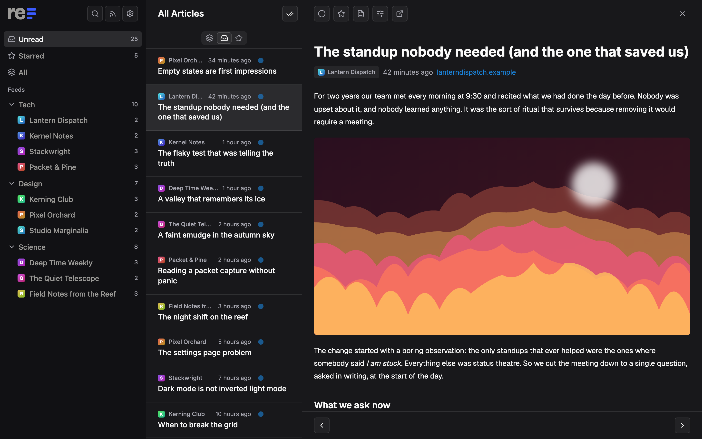
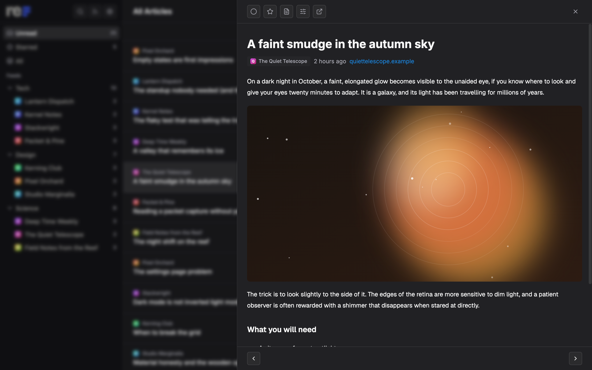
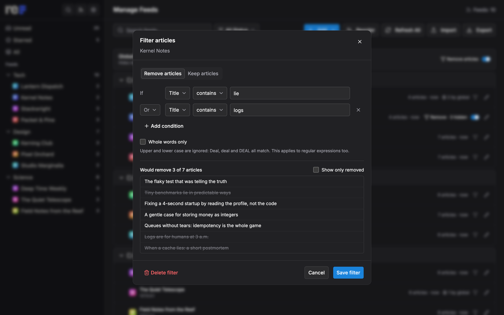
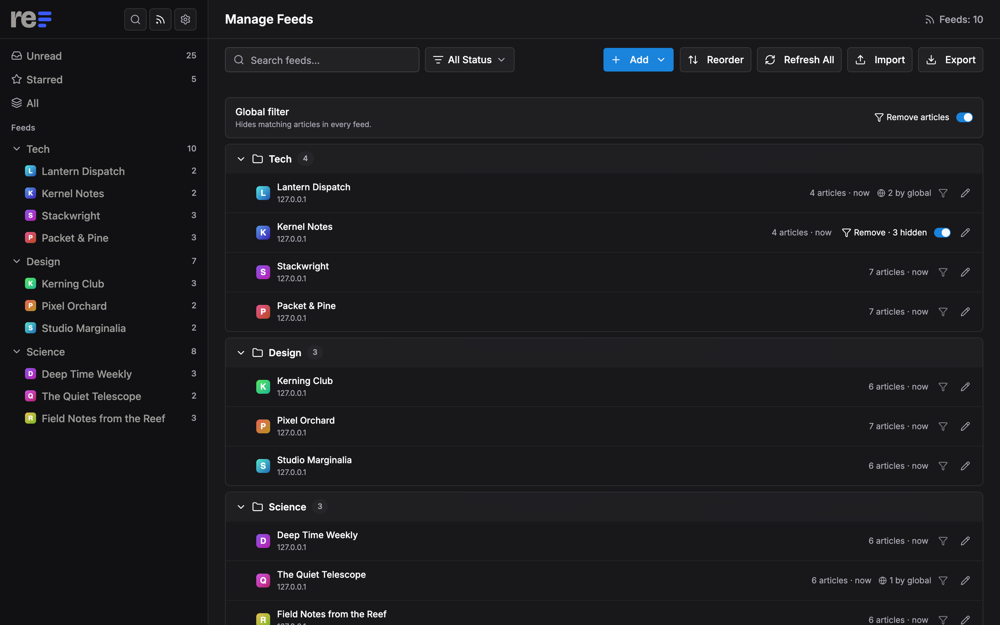
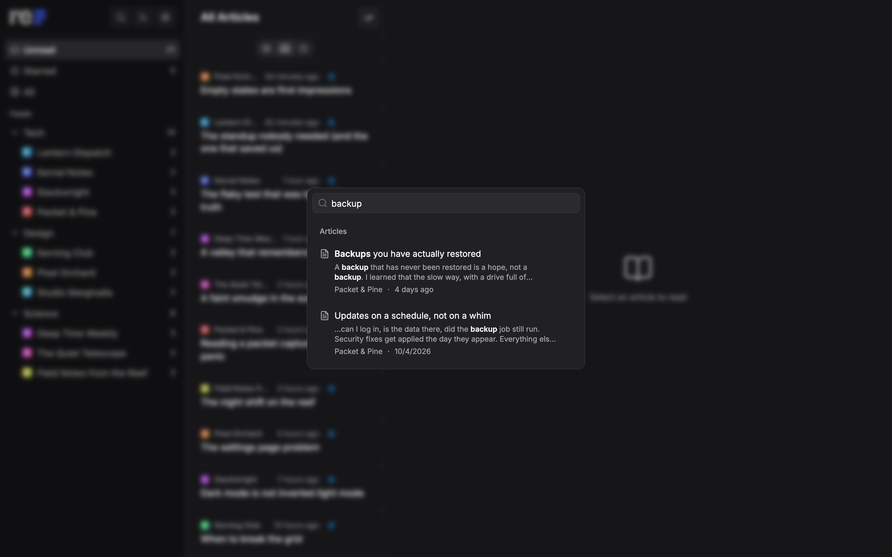

  <picture>
    <source media="(prefers-color-scheme: dark)" srcset="./assets/logo/refusion-logo-dark.svg" />
    
  </picture>

A lightweight, self-hosted RSS reader.

refusion is a web app for reading RSS and Atom feeds on your own server. It is a fork of [Fusion](https://github.com/0x2E/fusion), reshaped around how I read.

  

## At a glance

- **Reading:** two layouts, full article text on demand, YouTube in the article view
- **New articles:** pull to refresh with progress per feed, and the list never jumps
- **Filters:** hide articles per feed or everywhere, with a live preview
- **Organising:** folders in your own order, mark all as read, OPML
- **Search:** feeds and article text, with excerpts and Google Reader shortcuts
- **Self-hosting:** one binary and one SQLite file, Fever API for mobile apps, a PWA

## Features

### Reading

  

- **Panes:** the open article sits in a third column beside the list on wide screens.
- **Drawer:** the article slides over the list. Narrower windows use it even when Panes is chosen.
- **Full article:** press `w` to fetch the whole article from the site, or turn on "Always load full article" for a feed.
- **YouTube:** videos play inside the article view.
- **Text settings:** font and text size in the article view, and relative ("3 hours ago") or absolute dates.

### New articles

- **Pull to refresh:** pull down on the sidebar or the list, or press `r` for the current view and `shift+r` for every feed.
- **Progress:** each feed shows a spinner while it is checked, and a warning with the error when a check fails.
- **A steady list:** articles that arrive while you read are counted in a pill. Click it to load them.
- **Schedule:** feeds are checked in the background, and each feed can have its own interval.

### Filters

  

- **Feed filters:** remove or keep articles by title, content, URL, or whether they have pictures or video.
- **Conditions:** contains, is, begins with, ends with or a regular expression, joined by And or Or.
- **Live preview:** see which articles a filter would hide before you save it.
- **Global filter:** removes matching articles from every feed.
- **Hidden everywhere:** filtered articles stay out of lists, unread counts, search and Fever apps. In a single feed, "Also show filtered articles" brings them back, dimmed and tagged.

### Organising

  

- **Folders:** group feeds and collapse folders in the sidebar.
- **Reorder mode:** move folders and feeds up and down on the feeds page. The sidebar follows.
- **Mark all as read:** covers a whole feed or folder, including articles not loaded yet.
- **OPML:** import and export your subscriptions.

### Search and shortcuts

  

- **Search:** covers feeds and article text, with an excerpt and the matched words in bold.
- **Stars:** starred articles are saved as copies, so they survive when the feed or article is deleted.
- **Shortcuts:** Google Reader style (`j`/`k`, `m`, `s`, `g u`). Press `?` for the full list.

### Self-hosting and apps

- **Deployment:** a single binary with one SQLite file.
- **Fever API:** connect Reeder, Unread, FeedMe and other apps. See [`docs/fever-api.md`](./docs/fever-api.md).
- **PWA:** install it on a phone or desktop.
- **Sign-in:** a password, or OIDC.
- **Synced settings:** preferences follow you between devices. The reading layout stays per device.
- **Languages:** English, Chinese, German, French, Spanish, Russian, Portuguese and Swedish.

## How it differs from Fusion

Fusion provides the core: feed parsing and discovery, unread tracking, bookmarks, search, keyboard shortcuts, the Fever API and the PWA. refusion adds:

- the Panes layout, full article text and YouTube playback
- pull to refresh with progress per feed, and the new-articles pill
- feed and global filters
- reorder mode, search excerpts and the text settings

Upstream changes are merged in.

## Getting started

### Installation

TBD: refusion has no releases or Docker images yet. To build it yourself, see [Development](#development).

### Configuration

Settings are environment variables, listed with their defaults in [`.env.example`](./.env.example). They keep upstream's `FUSION_` prefix. Most setups only need `FUSION_PASSWORD`.

## Documentation

Design notes and API conventions are in [`docs/`](./docs/README.md).

## Development

- Go and Node.js versions are pinned in [`backend/go.mod`](./backend/go.mod) and [`frontend/package.json`](./frontend/package.json); you also need pnpm.
- Build and test commands are in [`scripts.sh`](./scripts.sh), e.g. `./scripts.sh build`. Local setup: [`CONTRIBUTING.md`](./CONTRIBUTING.md).

## Credits

- [Fusion](https://github.com/0x2E/fusion) by Rook1e, which refusion is forked from
- Feed parsing by [gofeed](https://github.com/mmcdole/gofeed)

> [!NOTE]
> **Built with AI help.** Most of what refusion adds to Fusion was written by coding agents, then reviewed, tried in the app and kept or thrown out by me. It's a personal tool shaped around how I read, not a polished product. The reader itself stays AI-free: no summaries, no recommendations, just your feeds.
